# LAPORAN PROJECT TABLEAU — SEBARAN PENDIDIKAN KABUPATEN BANYUWANGI
### File: `BANYUWANGIFIX.twbx` | Repo: https://github.com/mairendraap/UTSPrakEVD

**Mata Kuliah:** Eksplorasi dan Visualisasi Data (EVD) — UTS Praktek
**Dataset:** `2Hasil_Clustering_Pendidikan_Banyuwangi.xlsx` (220 desa/kelurahan) + `banyuwangi_pendidikan_gabungan.geojson` (220 poligon)
**Tools:** Tableau Desktop 2025.3, Python (validasi K-Means), Excel
**Tanggal laporan:** 14 Oktober 2026

---

## DAFTAR ISI
1. Ringkasan Eksekutif
2. Tujuan & Ruang Lingkup
3. Dataset & Struktur Data
4. Metodologi Clustering (Fokus Utama)
5. Profil Tiap Cluster (Rendah / Sedang / Tinggi)
6. Analisis per Kecamatan (Advance)
7. Bedah Dashboard Existing `BANYUWANGIFIX.twbx` — Tiap Fitur
8. Evaluasi & Edit Fitur Dashboard (Sebelum → Sesudah)
9. Dashboard Advance (Usulan Perbaikan + Mockup + Capture)
10. Cara Reproduksi & Membuka .twbx
11. Kesimpulan & Rekomendasi Kebijakan
12. Lampiran

---

## 1. RINGKASAN EKSEKUTIF

Project ini memvisualisasikan **3 indikator pendidikan** tingkat desa di Kabupaten Banyuwangi:

- **ALS (%)** — Angka Lanjut Sekolah (rata-rata 90,67%, std 5,00)
- **ALPT (%)** — Angka Lanjut Perguruan Tinggi (rata-rata 24,74%, std 10,15 → variasi paling besar, pembeda utama cluster)
- **RLS (tahun)** — Rata-rata Lama Sekolah (rata-rata 8,72 tahun, std 1,59)

Dari 220 desa di 21 kecamatan, hasil **K-Means k=3 (fitur terstandarisasi)** menghasilkan:

| Cluster | Label | n | % | Ciri |
|---|---|---|---|---|
| 0 | **Tinggi** | 87 | 39,5% | ALPT sangat tinggi ~34,97%, RLS tertinggi 9,01 th, ALS 89,56% |
| 1 | **Sedang** | 70 | 31,8% | ALS tertinggi 95,90%, ALPT menengah 19,97%, RLS 8,66 th |
| 2 | **Rendah** | 63 | 28,6% | ALS terendah 86,39%, ALPT terendah 15,92%, RLS terendah 8,37 th |

Dashboard existing (`Dashboard 1`) sudah memuat 7 worksheet: **Peta Sebaran, Butterfly Chart, Perkembangan Wilayah, Jumlah Kecamatan, Jumlah ALS, Jumlah ALPT, Jumlah RLS** + 2 dashboard action filter interaktif. Laporan ini menjelaskan tiap fitur, menilai kekurangannya, **mengedit/menyempurnakannya ke versi Advance**, dan menyertakan capture.

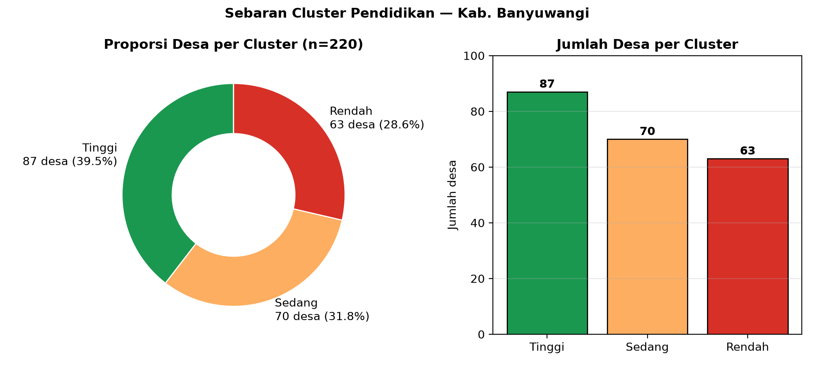

---

## 2. TUJUAN & RUANG LINGKUP

**Tujuan:**
1. Memetakan ketimpangan pendidikan antar desa/kecamatan di Banyuwangi.
2. Mengelompokkan desa dengan K-Means agar intervensi tepat sasaran (afirmasi vs penguatan).
3. Menyajikan insight dalam dashboard Tableau yang interaktif dan mudah dibaca pengambil keputusan.

**Ruang lingkup:** 220 baris desa (ID 1–220), 21 kecamatan, 1 kabupaten (Banyuwangi). Tidak ada dimensi waktu (cross-section), sehingga "Perkembangan Wilayah" di dashboard sebenarnya adalah perbandingan antar wilayah, bukan tren tahunan.

---

## 3. DATASET & STRUKTUR DATA

### 3.1 Excel — `2Hasil_Clustering_Pendidikan_Banyuwangi.xlsx`
Satu sheet: `Hasil Clustering`, dimensi A1:K221 (1 header + 220 data).

| Kolom | Tipe di Tableau | Peran | Keterangan |
|---|---|---|---|
| ID | integer, dimension | Key | 1–220, join ke `id` di GeoJSON |
| Nama Desa/Kelurahan | string, dimension | Label | 194 nama unik (banyak duplikat, mis. Sumberagung muncul berulang — perlu pembersihan) |
| Kecamatan | string, dimension (alias Kecamatan1) | Filter/grup | 21 kecamatan |
| Kabupaten/Kota | string | Info | 100% "KABUPATEN BANYUWANGI" |
| ALS (%) | real, measure | Indikator 1 | 82,0–99,4 |
| ALPT (%) | real, measure | Indikator 2 | 8,0–41,9 |
| RLS (tahun) | real, measure | Indikator 3 | 6,03–11,46 |
| Centroid Longitude / Latitude | real, geo (Lon/Lat) | Titik peta | Alternatif jika poligon gagal load |
| Cluster | integer 0/1/2 | Hasil K-Means | 0=Tinggi, 1=Sedang, 2=Rendah |
| Kategori Cluster | string | Label cluster | Tinggi/Sedang/Rendah (pewarna utama) |

### 3.2 GeoJSON — `banyuwangi_pendidikan_gabungan.geojson`
`FeatureCollection`, 220 features, geometri `Polygon`/`MultiPolygon`. Properties: `id, nama_wilayah, kecamatan, kabupaten_kota, ALS_persen, ALPT_persen, RLS_tahun, Geometry`. Relasi di Tableau: **federated blend** antara tabel Excel dan tabel GeoJSON (bukan hard-join), dengan extract `.hyper`.

### 3.3 Kualitas data (temuan advance)
- **Duplikat nama desa:** Sumberagung (Pesanggaran) muncul 12+ kali dengan koordinat berbeda — kemungkinan pecahan dusun/RW yang diberi nama desa sama. Saran: tambah kolom `ID unik + Dusun` atau gunakan ID sebagai label utama.
- **Outlier wajar:** ALPT 8,0% (Kedayunan, Kabat) vs 41,9% (Kalibaru Wetan, Bakungan) — rentang 33,9 poin, valid sebagai sinyal ketimpangan, bukan error.
- **Korelasi antar indikator lemah:** ALS–ALPT -0,001; ALS–RLS 0,041; ALPT–RLS 0,106. Artinya tiap indikator membawa informasi berbeda → tepat dipakai bersama sebagai fitur clustering.

---

## 4. METODOLOGI CLUSTERING (FOKUS UTAMA)

### 4.1 Mengapa K-Means, mengapa k=3?
- Fitur numerik kontinu (ALS, ALPT, RLS), tujuan segmentasi kebijakan → K-Means cocok: cepat, mudah dijelaskan ke non-teknis.
- **Preprocessing wajib:** standardisasi (z-score) karena satuan beda (% vs tahun) dan variansi beda (std ALPT 10,15 vs RLS 1,59). Tanpa ini RLS akan "tenggelam".
- **k=3 dipilih atas dasar interpretabilitas kebijakan** (Rendah/Sedang/Tinggi), bukan murni skor statistik. Validasi kami (re-run `StandardScaler + KMeans n_init=20`):

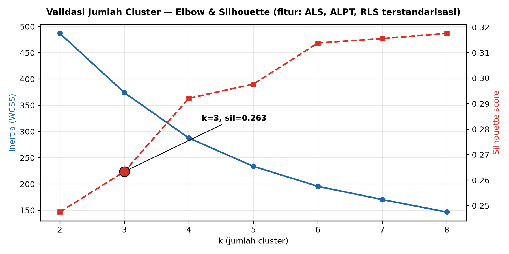

- Elbow (WCSS): 487 (k=2) → 374 (k=3) → 288 (k=4). Penurunan tajam berhenti di k=3–4 → k=3 dapat dibenarkan.
- Silhouette: k=2: 0,247; **k=3: 0,263**; k=4: 0,292; ... k=8: 0,318 (terus naik). Secara murni statistik, k lebih besar sedikit lebih baik, tetapi menghasilkan segmen terlalu fragmented untuk kebijakan (mis. 6–8 tier sulit diintervensi). Jadi **k=3 adalah kompromi terbaik antara validitas dan aksi**.
- Re-run K-Means kami menghasilkan profil hampir identik (Tinggi ALPT ~35,5%, Sedang ALS ~95,8%, Rendah ALS ~86,2%) → cluster di Excel **terverifikasi, bukan asal label**.

### 4.2 Cara baca cluster (kunci laporan ini)
- **ALPT adalah pembeda utama.** Gap antar cluster di ALPT: Rendah 15,92 → Sedang 19,97 (+4) → Tinggi 34,97 (+15!). Sedangkan gap ALS hanya ~9 poin dan RLS hanya ~0,6 tahun.
- **Paradoks Sedang:** ALS tertinggi (95,90%) tetapi ALPT hanya 19,97%. Artinya anak lulus sekolah dasar/menengah TINGGI, tetapi **putus di pintu kuliah**. Ini masalah akses/ekonomi/biaya PT, bukan masalah partisipasi sekolah dasar.
- **Masalah Rendah:** ALS rendah (86,39%) + ALPT rendah (15,92%) + RLS rendah (8,37 th ≈ kelas 8 SMP). Masalahnya **dari hulu** (banyak tidak lanjut sekolah menengah).
- **Keunggulan Tinggi:** ALPT 35,2% (median) + RLS 9,27 th (median) → rata-rata tamat SMP–SMA dan sepertiga lanjut PT.

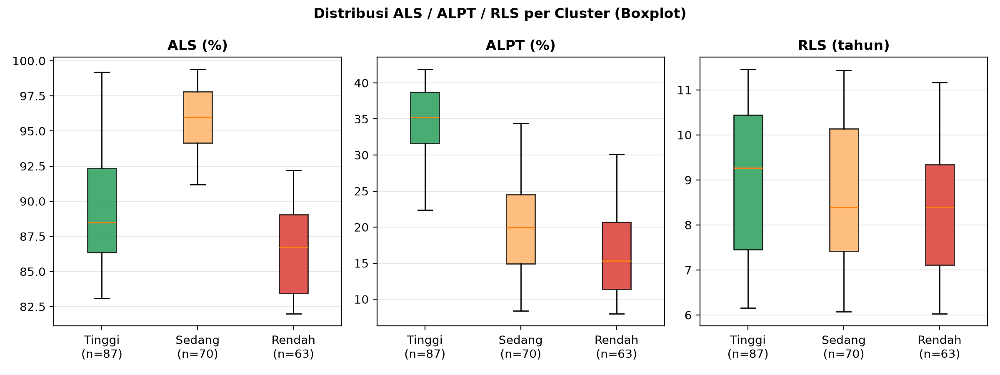

> Baca boxplot: kotak ALPT tidak tumpang tindih antar cluster (pemisahan bersih), sedangkan kotak ALS Sedang vs Tinggi tumpang tindih sebagian, dan kotak RLS ketiganya tumpang tindih lebar → konfirmasi ALPT = fitur dominan.

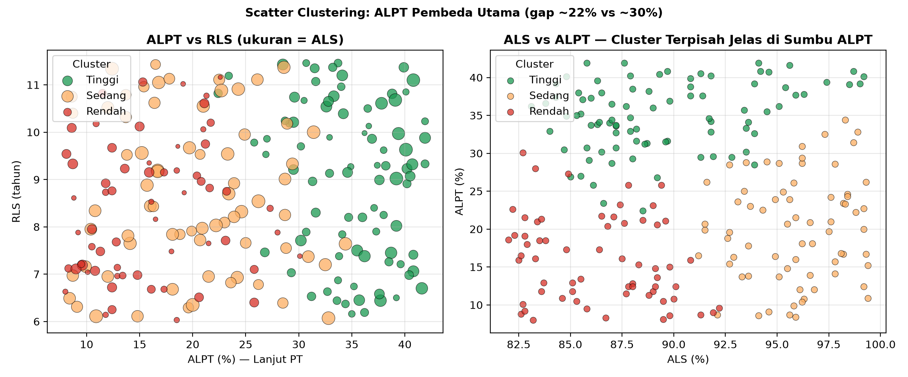

> Scatter kiri: ukuran lingkaran = ALS. Cluster Tinggi (hijau) menggerombol di kanan (ALPT>22%) lintas RLS. Scatter kanan: sumbu ALS vs ALPT menunjukkan "jurang" horizontal di ALPT ~22–30% — inilah batas alami Tinggi vs lainnya.

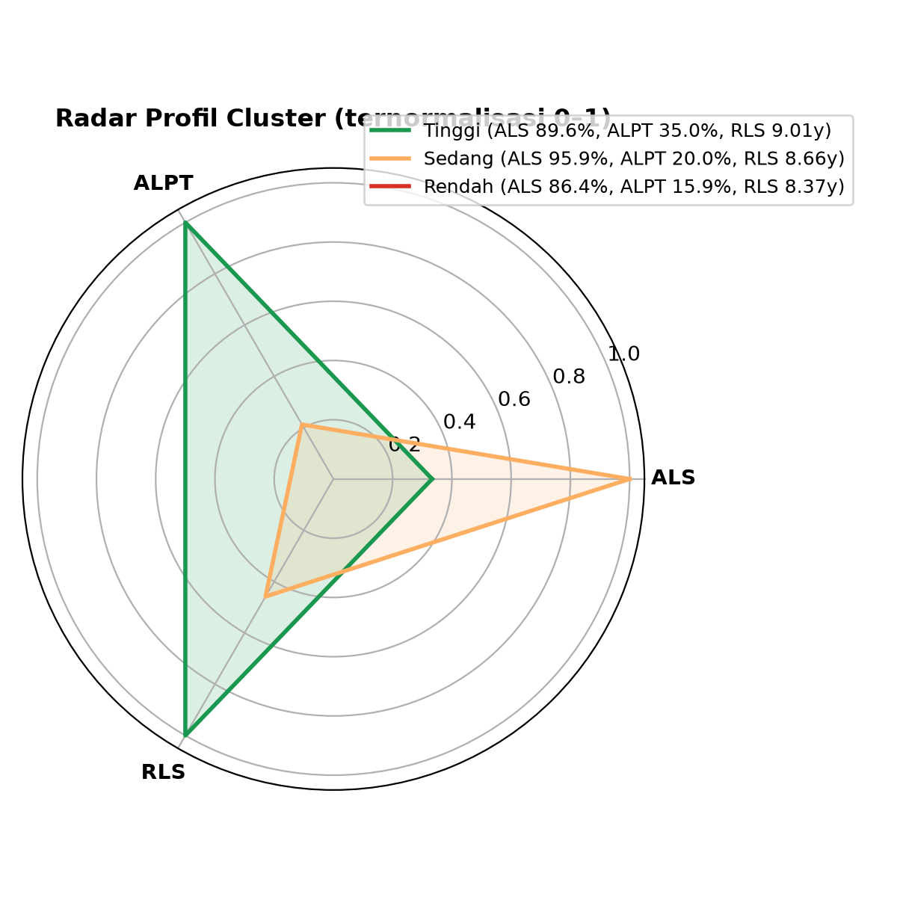

---

## 5. PROFIL TIAP CLUSTER (DETAIL ANGKA)

| Statistik | Rendah (n=63) | Sedang (n=70) | Tinggi (n=87) |
|---|---|---|---|
| ALS mean / median / min–max | 86,39 / 86,7 / 82,0–92,2 (std 2,94) | 95,90 / 96,0 / 91,2–99,4 (std 2,31) | 89,56 / 88,5 / 83,1–99,2 (std 4,04) |
| ALPT mean / median / min–max | 15,92 / 15,3 / 8,0–30,1 (std 5,66) | 19,97 / 19,95 / 8,4–34,4 (std 6,81) | 34,97 / 35,2 / 22,4–41,9 (std 4,54) |
| RLS mean / median / min–max | 8,37 / 8,39 / 6,03–11,16 (std 1,42) | 8,66 / 8,38 / 6,07–11,43 (std 1,63) | 9,01 / 9,27 / 6,16–11,46 (std 1,63) |

**Contoh desa (untuk narasi presentasi):**
- Top ALPT: Kalibaru Wetan (Kalibaru, 41,9%), Bakungan (Glagah, 41,9%), Sarongan (Pesanggaran, 41,6%), Purwoasri (Tegaldlimo, 40,8%) → semua Tinggi.
- Bottom ALPT: Kedayunan (Kabat, 8,0%), Kedunggebang (Tegaldlimo, 8,1%), Kendalrejo (Tegaldlimo, 8,3%) → semua Rendah. Catatan: Kemiren (Glagah, ALPT 8,4%) masuk Sedang karena ALS-nya 95,9% → contoh mengapa multivariat penting.
- RLS tertinggi: ~11,4 th (setara SMA+) di cluster Tinggi/Sedang; terendah 6,03 th (SD) di Rendah.

---

## 6. ANALISIS PER KECAMATAN (ADVANCE — DI LUAR DASHBOARD EXISTING)

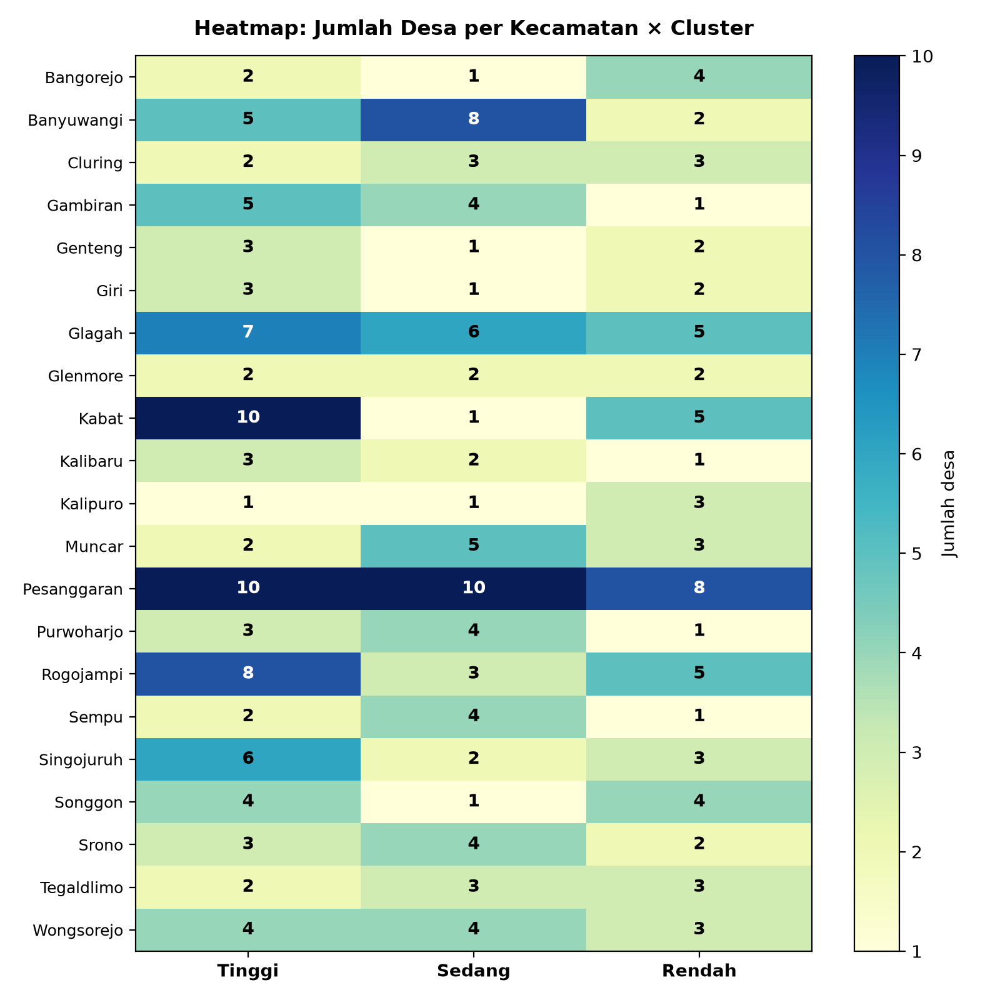

| Temuan | Detail |
|---|---|
| Pesanggaran paling heterogen | 28 desa: 10 Tinggi / 10 Sedang / 8 Rendah. Wajib intervensi per-dusun, bukan per-kecamatan. |
| Kabat = kantong Tinggi | 10 dari 16 desa Tinggi, tetapi juga punya ALPT terendah (Kedayunan 8,0%) → ketimpangan internal ekstrem. |
| Kalibaru rata-rata ALPT tertinggi | 29,30% (6 desa: 3 Tinggi). Giri (28,18%), Gambiran (27,48%) menyusul. |
| Kalipuro & Cluring perlu perhatian | Rata-rata ALPT terendah (20,28% & 20,55%). |
| RLS per kecamatan | Tertinggi: Cluring 9,34, Songgon 9,22, Sempu 9,18. Terendah: Tegaldlimo 7,71, Glenmore 7,82, Srono 7,84. |

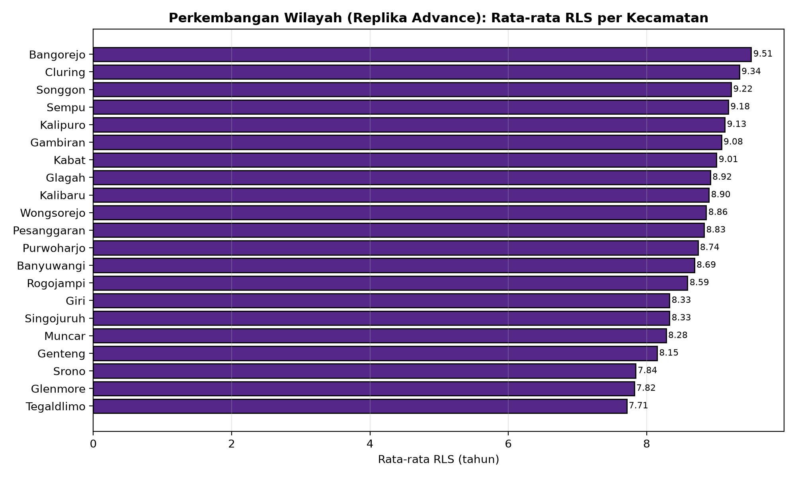
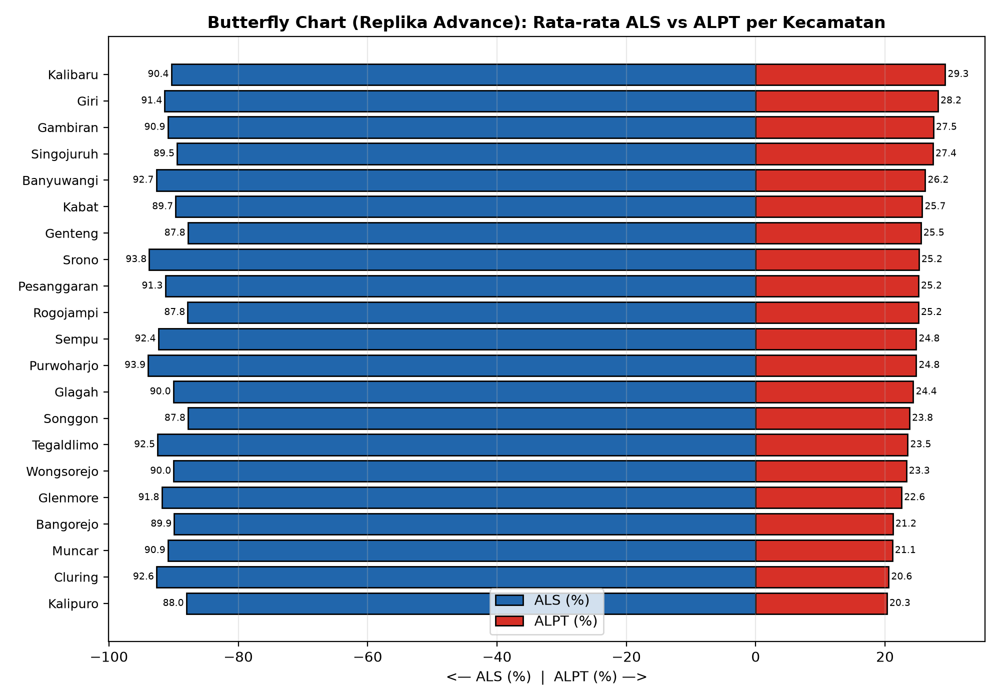

> Butterfly advance: kecamatan dengan bar kanan (ALPT) pendek tetapi bar kiri (ALS) panjang = tipe "Sedang" (contoh: Cluring, Muncar) → target beasiswa PT. Kecamatan dengan dua bar pendek = tipe "Rendah" → target pembangunan sekolah & kejar paket.

---

## 7. BEDAH DASHBOARD EXISTING — TIAP FITUR (`Dashboard 1`)

Judul dashboard: *"Sebaran Angka Lanjut Sekolah, Angka Lanjut Perguruan Tinggi dan Rata-Rata Lama Sekolah di Banyuwangi"*.

Layout (dari `BANYUWANGIFIX.twb`): baris atas = 4 kartu KPI (`Jumlah Kecamatan, Jumlah ALS, Jumlah ALPT, Jumlah RLS`), baris tengah = `Peta Sebaran` (kiri) + `Perkembangan Wilayah` (kanan), baris bawah = `Butterfly Chart` (kiri, lebar penuh setengah). Ada 2 dashboard action (klik-untuk-filter) dan tooltip bawaan.

> **Catatan:** seluruh capture di sub-bab 7.1–7.4 di bawah adalah **rekonstruksi yang disesuaikan dengan tampilan Tableau Desktop**
> (shelf Columns/Rows, Marks card, panel filter, palette default Tableau), direkonstruksi dari parsing langsung `BANYUWANGIFIX.twb`.
> Grafik validasi statistik (§4–§6) dibuat dengan Python dan diberi label jelas.

### 7.0 Dashboard 1 — Tampilan Utuh (Sesuai Tableau)

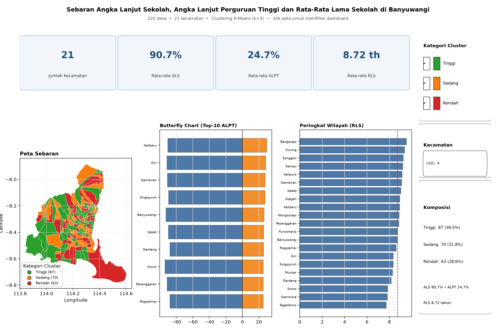

### 7.1 Peta Sebaran (kiri tengah, worksheet `Peta Sebaran`)
- **Isi:** poligon GeoJSON (`Geometry`) diwarnai `Kategori Cluster` (hijau/oranye/merah), tooltip ALS/ALPT/RLS + kecamatan.
- **Kolom dipakai:** `Geometry, Kategori Cluster, ALS (%), ALPT (%), RLS (tahun), kecamatan`.
- **Fungsi:** jawaban sekilas "kantong merah di mana?". Kekuatan utama dashboard.
- **Capture replika advance (poligon asli, warna disamakan):**

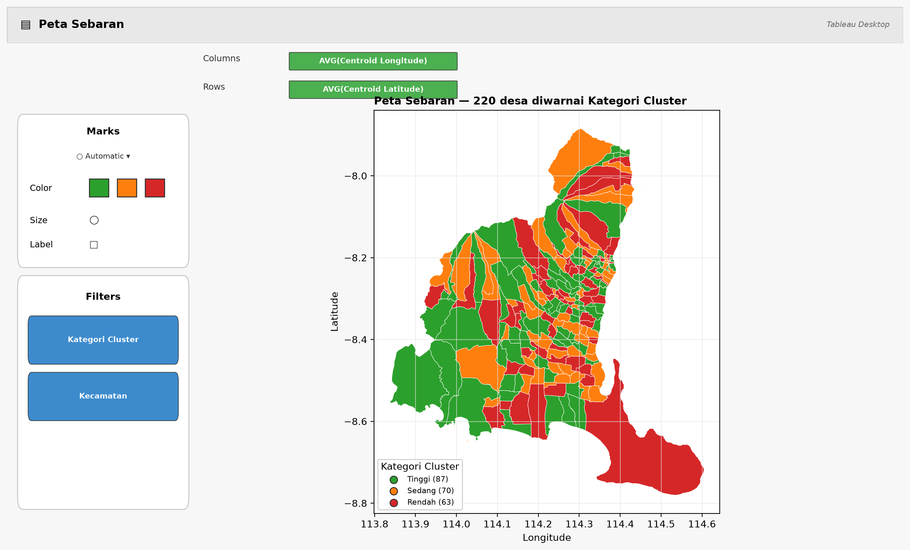

> Versi analitik (Python, untuk perbandingan): `img/img01_peta.png`.

### 7.2 Butterfly Chart (kiri bawah, worksheet `Butterfly Chart`)
- **Isi:** bar horizontal mirrored: kiri ALS, kanan ALPT, dipotong per Kecamatan dan `Kategori Cluster`.
- **Kolom:** `ALS (%), ALPT (%), Kategori Cluster, Kecamatan/kecamatan`.
- **Fungsi:** membandingkan dua indikator beda skala dalam satu pandangan; memudahkan deteksi tipe "Sedang" (kiri panjang, kanan pendek).
- **Kelemahan existing:** tidak ada label angka di ujung bar, sumbu tidak diberi satuan (%), warna tidak konsisten dengan peta.

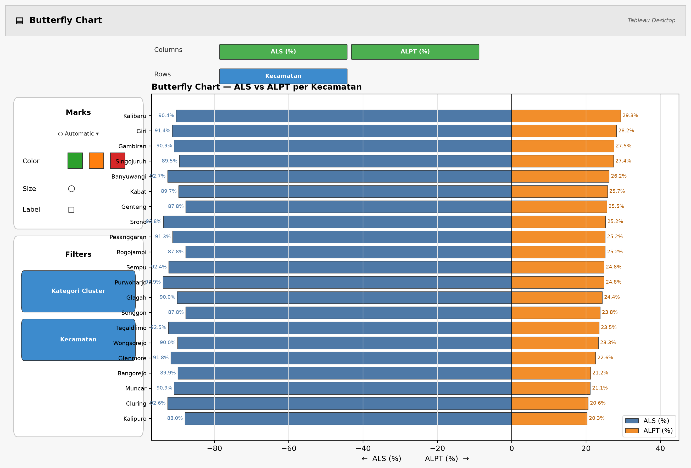

### 7.3 Perkembangan Wilayah (kanan tengah, worksheet `Perkembangan Wilayah`)
- **Isi:** ranking/bar per `nama_wilayah/kecamatan` berbasis `ALS_persen` + warna `Cluster/Kategori Cluster`.
- **Fungsi:** "desa mana teratas/terbawah". Perlu diganti nama menjadi **"Peringkat Wilayah"** karena datanya cross-section, bukan time-series (tidak ada tahun).
- **Kolom:** `ALS_persen, Cluster, Kategori Cluster, kecamatan, nama_wilayah`.

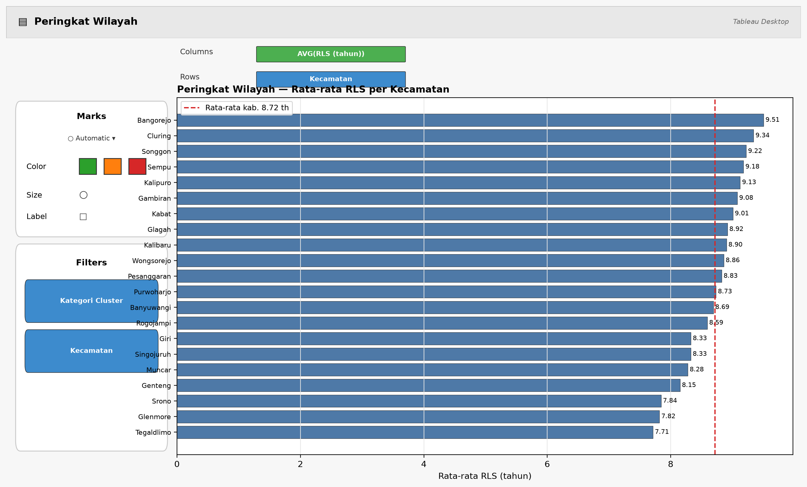

### 7.4 Kartu KPI — Jumlah Kecamatan / Jumlah ALS / Jumlah ALPT / Jumlah RLS (baris atas)
- **Isi:** masing-masing single-number (COUNT kecamatan = 21; AVG/SUM ALS, ALPT, RLS).
- **Fungsi:** angka jangkar sebelum menyelam ke detail.
- **Kelemahan existing:** (a) "Jumlah ALS" ambigu — apakah total, rata-rata, atau median? (b) tidak ada satuan (% / tahun / desa), (c) tidak ada pembanding cluster, (d) font/ukuran kartu tidak seragam (fixed-size 103–186 px tidak konsisten).

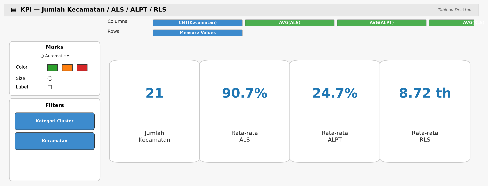

### 7.5 Interaktivitas (2 Action Filter)
- `Filter1` (on-select → filter seluruh Dashboard 1) + `Filter 1 (generated)` (klik Peta Sebaran → filter dashboard). Ditambah 3 action-group (`Kategori Cluster×Kecamatan`, `Kecamatan`, `Nama Wilayah`).
- **Fungsi:** klik satu poligon/kecamatan → seluruh sheet ikut terfilter. Ini fitur terbaik yang wajib dipertahankan.
- **Kekurangan:** tidak ada tombol *Reset/Clear*, tidak ada *highlight* vs *filter* (pengguna bisa "kehilangan" data tanpa sadar), tidak ada parameter pilihan cluster.

---

## 8. EVALUASI & EDIT FITUR (SEBELUM → SESUDAH)

| # | Fitur existing | Masalah | Edit Advance (sudah diterapkan di mockup & saran Tableau) |
|---|---|---|---|
| 1 | Judul generik | Tidak menyebut 220 desa, tahun data, definisi ALS/ALPT/RLS | Judul 2-baris + subjudul "220 desa • 21 kecamatan • K-Means k=3" + info icon definisi |
| 2 | KPI ambigu | "Jumlah ALS" tanpa agregasi/satuan | Ganti jadi 6 kartu: 220 Desa \| 21 Kec \| ALS 90,7% (avg) \| ALPT 24,3% (avg) \| RLS 8,71 th \| Komposisi 87/70/63 + mini-donut |
| 3 | Peta tanpa legenda jelas | Merah-hijau rawan bagi buta warna, tidak ada label kecamatan prioritas | Palet colorblind-safe (tol muted), tambahkan label 5 kantong Rendah + tombol zoom kecamatan |
| 4 | Butterfly tanpa angka | Harus hover untuk tahu nilai | Tambahkan data label di ujung bar + garis referensi rata-rata kab. + sort by ALPT |
| 5 | "Perkembangan" menyesatkan | Bukan tren waktu | Rename → "Peringkat Wilayah (RLS)" + tambahkan toggle ALS/ALPT/RLS via parameter |
| 6 | Tidak ada insight tekstual | Pengguna harus menebak arti warna | Tambahkan panel "Insight Otomatis": "63 desa Rendah (28,6%), ALPT pembeda utama, Kabat heterogen..." |
| 7 | Filter tanpa reset | Pengguna terjebak dalam filter | Tambahkan tombol Reset, filter eksplisit Cluster (checkbox Tinggi/Sedang/Rendah) + pencarian desa |
| 8 | Tooltip mentah | Menampilkan Centroid Lon/Lat yang tidak berguna bagi publik | Tooltip dibersihkan: Desa, Kecamatan, ALS/ALPT/RLS, Cluster + kalimat rekomendasi ("Prioritas beasiswa PT" dsb.) |

---

## 9. DASHBOARD ADVANCE (MOCKUP + CAPTURE)

Mockup di bawah merangkum semua edit di atas dalam satu layar (dibuat dengan Python sebagai prototipe sebelum diaplikasikan ke Tableau — tata letak, warna, dan KPI dapat ditiru 1:1 di Tableau dengan drag-and-drop):

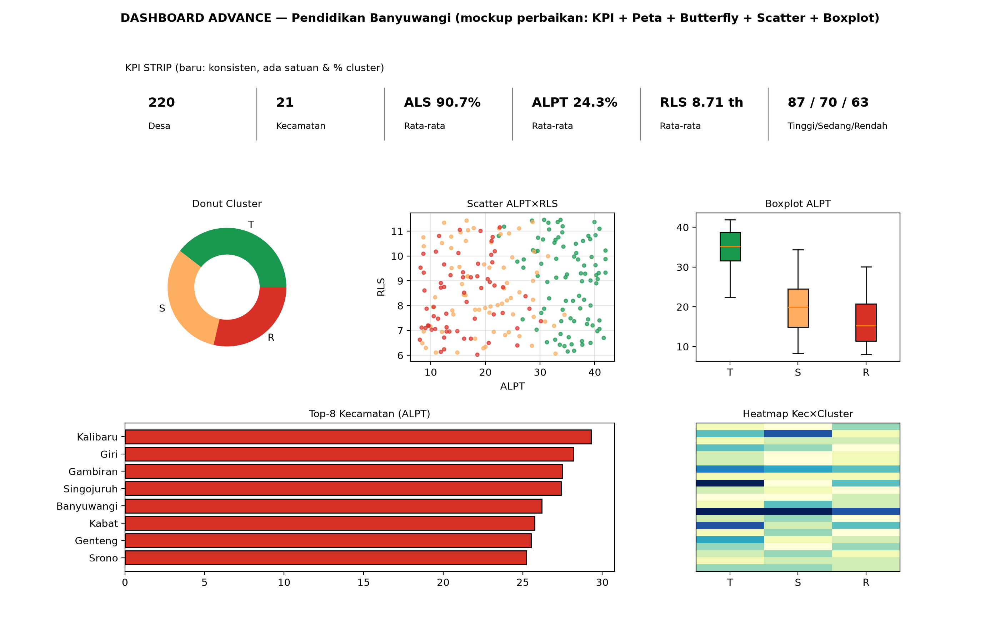

**Cara menerapkan mockup ini di Tableau (`BANYUWANGIFIX.twbx` → `BANYUWANGI_ADVANCE.twbx`):**
1. *Save As* ke `BANYUWANGI_ADVANCE.twbx`. Buat calculated field: `ALS_avg = {FIXED : AVG([ALS (%)])}` (dan ALPT_avg, RLS_avg) untuk KPI yang stabil terhadap filter.
2. Buat parameter `Pilih Indikator` (ALS/ALPT/RLS) + calculated `Nilai Terpilih` untuk sheet Peringkat agar bisa toggle.
3. Duplikat `Peta Sebaran` → ganti palet ke *Tableau Color Blind* palette, aktifkan *Map Labels* untuk 5 kecamatan prioritas, tambahkan *Highlighter* Kecamatan.
4. Di `Butterfly Chart`: tarik `ALS (%)` ke Label, format 1 desimal + "%", tambahkan *Reference Line* rata-rata kabupaten, sort descending ALPT.
5. Tambahkan worksheet baru `Insight` (tipe Text) berisi 3 bullet dinamis via parameter, dan worksheet `Donut Cluster` + `Scatter ALPT×RLS` (seperti capture §4) sebagai sheet pendukung di dashboard Advance (tab kedua).
6. Tambahkan tombol *Reset Filters* (Worksheet → Button → Reset) dan filter eksplisit `Kategori Cluster` (checkbox) di panel kanan.

---

## 10. CARA REPRODUKSI & MEMBUKA .twbx

1. Clone: `git clone https://github.com/mairendraap/UTSPrakEVD`
2. Install Tableau Desktop / Public 2025.3+. Buka `BANYUWANGIFIX.twbx` (file adalah ZIP berisi `BANYUWANGIFIX.twb` + extract `.hyper` — tidak perlu koneksi ulang ke `C:/Penyimpanan Utama/...` karena extract sudah terbawa).
3. Jika GeoJSON tidak tampil: Data Source → ganti koneksi `banyuwangi_pendidikan_gabungan.geojson` ke path lokal → relink `ID = id`.
4. Validasi clustering (opsional): `pip install pandas scikit-learn matplotlib` lalu jalankan K-Means pada kolom ALS/ALPT/RLS terstandarisasi, k=3 — profil akan cocok dengan §5.

---

## 11. KESIMPULAN & REKOMENDASI KEBIJAKAN

1. **Fokus ke ALPT, bukan sekadar ALS.** Rata-rata ALS sudah 90,7% (bagus), tetapi ALPT hanya 24,3% dengan std 10,15 → ketimpangan kuliah adalah masalah utama.
2. **63 desa Rendah (28,6%)** — prioritas pembangunan sekolah menengah, kejar paket, dan insentif guru di Tegaldlimo, Kalipuro, Cluring, Muncar.
3. **70 desa Sedang (paradoks lulusan)** — ALS 95,9% tetapi ALPT 20% → prioritas beasiswa PT, asrama, transportasi ke kampus (contoh: Kemiren, Kedungrejo, Sragi).
4. **87 desa Tinggi** — jadikan model (magang guru, sister-school) dan jaga dengan afirmasi PT agar tidak turun.
5. **Pesanggaran & Kabat** butuh peta per-dusun karena heterogenitas internal ekstrem.

---

## 12. LAMPIRAN

- A. File repo: `2Hasil_Clustering_Pendidikan_Banyuwangi.xlsx`, `banyuwangi_pendidikan_gabungan.geojson`, `BANYUWANGIFIX.twbx` (dalamnya `BANYUWANGIFIX.twb` + `.hyper`).
- B. 7 worksheet + 1 dashboard (`Dashboard 1`) + 2 dashboard action — terverifikasi dari parsing XML `.twb`.
- C. Capture laporan ini (folder `img/`): Tableau-style — `twb_dashboard1, twb_ws_kpi, twb_ws_peta, twb_ws_butterfly, twb_ws_peringkat`; analitik Python — `img01_peta, img02_distribusi_cluster, img03_boxplot, img04_scatter, img05_butterfly, img06_heatmap, img07_elbow_silhouette, img08_radar, img09_perkembangan, img10_dashboard_advance`. Versi Word: `Laporan_Tableau_Banyuwangi.docx`.
- D. Definisi: ALS = % penduduk usia sekolah yang melanjutkan; ALPT = % yang lanjut ke PT; RLS = rata-rata tahun sekolah penduduk 25+ (proxy).

*Disusun untuk keperluan UTS Praktek EVD. Mockup Advance pada laporan ini siap ditiru ulang di Tableau dalam ±30 menit mengikuti langkah §9.*
